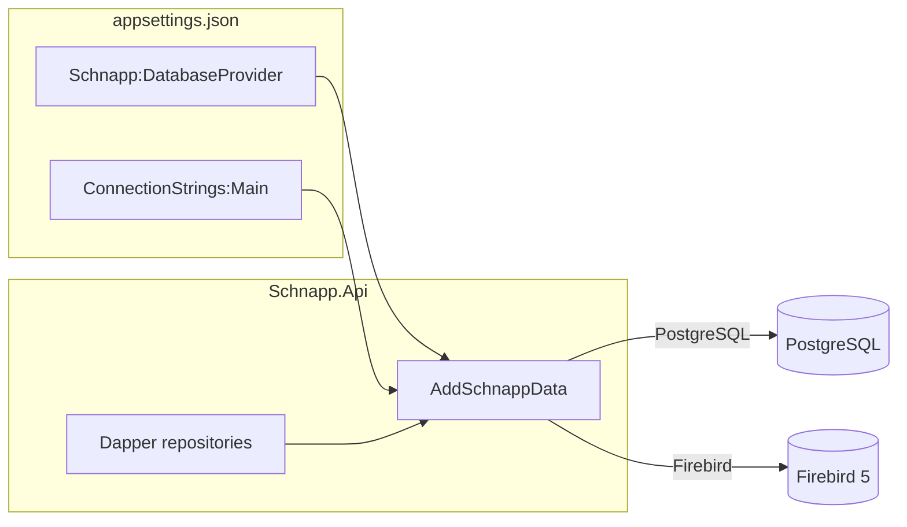

# Firebird SQL assessment and implementation plan

| Field | Value |
|-------|--------|
| **Date** | 2026-09-03 |
| **Status** | Implemented (design record) |
| **Scope** | Schnapp **server** metadata store (`Schnapp.Api`). Image files stay on the filesystem. |

Dual-engine support described here is in the API. Set `Schnapp:DatabaseProvider` to `PostgreSQL` (default) or `Firebird` and supply a matching `ConnectionStrings:Main`. Fedora install steps are in [deployment-fedora.md](deployment-fedora.md). The QNAP appliance image still ships PostgreSQL only.

This document compares **PostgreSQL** and **Firebird SQL** as the catalog engine, then records how **runtime support for either** is chosen in `appsettings.json`. It does not argue from prior engine-selection notes. It does **not** cover moving data from one engine to the other.

---

## Overview

Schnapp.Api is the only process that talks SQL. It uses Dapper over ADO.NET (`IDbConnectionFactory`), DbUp for numbered SQL migrations, and app-minted UUIDv7 keys. `Schnapp.Web` and the trays talk HTTP only.

Both PostgreSQL and Firebird can host this catalog. The useful question is engine fit and ops preference, not whether Firebird is “capable enough.”

**Target:** one API process uses **one** engine. The operator sets `Schnapp:DatabaseProvider` (`PostgreSQL` or `Firebird`) and a matching `ConnectionStrings:Main`. Startup wires the matching driver, migrations, and SQL dialect. A new install creates an empty database of the chosen engine. There is no export/import, dual-write, or conversion path between engines.

---

## Goals and non-goals

**Goals**

- Compare PostgreSQL and Firebird on their own merits for a small multi-user metadata catalog with concurrent writers.
- Support **either** engine in Schnapp.Api, selected from `appsettings.json` (and the usual environment-variable override).
- Keep HTTP contracts, Web, trays, and filesystem blobs unchanged.

**Non-goals**

- Inferring a reason to prefer one engine.
- Client-side local storage.
- Putting screenshot bytes in the database.
- Migrating, copying, or converting data from PostgreSQL to Firebird or the reverse.
- Running both engines in one process.

---

## Key decisions

| Decision | Choice | Why |
|----------|--------|-----|
| Selection | `Schnapp:DatabaseProvider` = `PostgreSQL` \| `Firebird` | Explicit. Do not infer the engine from the connection string. |
| Connection | `ConnectionStrings:Main` (same key, provider-specific value) | Matches today; only the string format changes with the provider. |
| Default | `PostgreSQL` if the key is omitted | Existing `appsettings.json` / `api.env` keep working. |
| Process model | One provider per process | Factory, dialect, and DbUp scripts are chosen at startup. |
| Data access | Keep **Dapper + DbUp**; both drivers in `Schnapp.Data` | `Npgsql` + `dbup-postgresql` and `FirebirdSql.Data.FirebirdClient` + `dbup-firebird`. No EF Core. |
| SQL | Shared repositories + a small dialect + two strings where SQL actually differs | Avoid two full repository class trees. Avoid a lowest-common-denominator that throws away `ON CONFLICT` / `MERGE`. |
| Migrations | Two folders of embedded scripts | PostgreSQL scripts stay; Firebird gets its own `001`… sequence. DbUp filters by folder. |
| Firebird version | **Firebird 5** | Partial unique indexes (`CREATE UNIQUE INDEX … WHERE`), MERGE. Do not spike on Firebird 4 (Testcontainers’ default image). |
| Firebird process | **SuperServer** (port 3050) | Same shape as today’s Postgres daemon. Not Embedded. |
| IDs (Firebird) | `BINARY(16)` + `FbDbType.Binary` | No UUID type. Write RFC/network bytes from `Uuid7.ToByteArray()`. Do **not** use `FbDbType.Guid`. |
| JSON (Firebird) | `BLOB SUB_TYPE TEXT` | Opaque store; Schnapp does not query inside JSON. |
| Timestamps (Firebird) | UTC `TIMESTAMP` (no time zone) | Same instants as today’s `timestamptz`, stored as naive UTC. See [Date and time](#date-and-time). |
| Text (Firebird) | **`VARCHAR`** | All PostgreSQL `text` columns. Unique/indexed identifiers `VARCHAR(255)`; tag bags `VARCHAR(1024)`; notes/window titles `VARCHAR(2048)`; `setting.value` `VARCHAR(8191)`. Row size stays under Firebird’s 64 KiB record limit. Not `BLOB`. |
| Blobs | Unchanged filesystem | Independent of engine. |

---

## PostgreSQL vs Firebird

Comparison is about the engines, not about Schnapp’s current driver or migration scripts.

### PostgreSQL

A general-purpose client/server RDBMS. Strong SQL, MVCC, and a large ops/tooling ecosystem. On Fedora it is `postgresql-server` plus a cluster (`PGDATA`, roles, `pg_hba`).

**Pros**

- SQL surface: `jsonb`, native `uuid`, `timestamptz`, `ON CONFLICT`, partial unique indexes, `LATERAL`, rich time-zone conversion.
- Concurrency: MVCC, read committed as the usual default, connection pooling (Npgsql) is mature.
- .NET: Npgsql is first-class; Dapper and DbUp (`dbup-postgresql`) are well-trodden.
- Ops: `pg_dump` / `pg_restore`, streaming replication if ever needed, huge operator pool and documentation.
- Fedora packaging and systemd integration are routine.

**Cons**

- Heavier operational surface than a single-file engine (cluster init, roles, auth config, extra daemon).
- Larger default memory/disk footprint.
- More engine than a single-org metadata catalog strictly needs.

### Firebird SQL

A smaller SQL RDBMS with a long history in single-server applications. License is IPL + IDPL (MPL-style). Schnapp uses **SuperServer**: Fedora package + daemon on port 3050, one `.fdb` file.

**Pros**

- Small footprint; SuperServer is a modest daemon.
- Real SQL: transactions, FKs, indexes, MERGE, Firebird 5 partial unique indexes, CTEs, window functions.
- One-file database; `gbak` / `nbackup` while SuperServer is running.
- Production ADO.NET provider (`FirebirdSql.Data.FirebirdClient`) works with Dapper; `dbup-firebird` exists.
- Fine for modest concurrent writers on one host.

**Cons**

- Smaller ecosystem: fewer operators, fewer .NET examples, less Stack Overflow / hiring depth.
- No native UUID; no `jsonb` (store JSON as text/BLOB).
- Dialect is not PostgreSQL: health ping needs `FROM RDB$DATABASE`; `LIMIT` → `ROWS` / `FETCH FIRST`; no `ON CONFLICT` / `ANY(array)`; no `LATERAL`.
- Engine default isolation is SNAPSHOT; ADO.NET FirebirdClient defaults to ReadCommitted (use that explicitly on `BeginTransaction`).
- `VARCHAR` is bounded (UTF8 unique indexes max out around 255 characters; free text max `VARCHAR(8191)`).
- Testcontainers.FirebirdSql defaults to **Firebird 4**, which lacks partial unique indexes — pin **5**.

### Head-to-head

| Topic | PostgreSQL | Firebird 5 |
|-------|------------|------------|
| Fit for concurrent tray uploads + web reads | Yes | Yes (SuperServer) |
| Fedora install | `postgresql-server` | `firebird` SuperServer |
| .NET | Npgsql | FirebirdClient |
| UUID | Native `uuid` | `BINARY(16)` + app mapping |
| JSON | `jsonb` | Text/BLOB; no GIN |
| Upsert | `ON CONFLICT` | `UPDATE OR INSERT` / `MERGE` |
| Partial unique index | Yes | Yes on **5** (not 4) |
| Time zones | `timestamptz`, `AT TIME ZONE` | UTC `TIMESTAMP`; local dates in query/C# |
| Backup | `pg_dump` | `gbak` / `nbackup` |
| Replication | Unused here; excellent if needed | Exists; less commonly operated |
| Community / ops familiarity | High | Low |

Neither engine is a poor fit. PostgreSQL is the stronger general-purpose server SQL platform. Firebird is the smaller, simpler-to-host alternative.

---

## What Schnapp.Api needs from a catalog

Capabilities, not current SQL:

- ACID, foreign keys, indexes on `(user_id, timestamp_utc)` for day-range screenshot lists.
- Concurrent inserts (several trays) plus web reads.
- App-generated time-sortable ids (UUIDv7).
- Instants in UTC; reports that group by a profile time zone’s calendar day.
- Opaque JSON on screenshot fingerprints and a few machine fields (store only, no JSONPath).
- Idempotent upserts (settings, journal targets, user–machine links).
- **At most one open journal per user+machine** (filtered unique index).
- Modest row counts: lists/users/machines/journals are small; `screenshot` is the growth table (metadata only).

Firebird 5 SuperServer covers this. Dual support is dialect and types, not missing engine features.

---

## Dual-engine support (appsettings)

### Configuration

Add an explicit provider next to the existing connection string. Do not guess the engine from `Main`.

PostgreSQL (today’s default; `DatabaseProvider` may be omitted):

```json
{
  "ConnectionStrings": {
    "Main": "Host=127.0.0.1;Port=5432;Database=schnapp;Username=schnapp;Password=schnapp"
  },
  "Schnapp": {
    "DatabaseProvider": "PostgreSQL",
    "BlobRoot": "/opt/schnapp/data/blobs",
    "MigrateOnStartup": true
  }
}
```

Firebird SuperServer:

```json
{
  "ConnectionStrings": {
    "Main": "DataSource=127.0.0.1;Port=3050;Database=/opt/schnapp/data/firebird/schnapp.fdb;User=schnapp;Password=schnapp;Charset=UTF8;Dialect=3"
  },
  "Schnapp": {
    "DatabaseProvider": "Firebird",
    "BlobRoot": "/opt/schnapp/data/blobs",
    "MigrateOnStartup": true
  }
}
```

Environment overrides (same as the rest of the host config):

```
Schnapp__DatabaseProvider=Firebird
ConnectionStrings__Main=DataSource=127.0.0.1;Port=3050;Database=/opt/schnapp/data/firebird/schnapp.fdb;User=schnapp;Password=***;Charset=UTF8;Dialect=3
```

Allowed values: `PostgreSQL`, `Firebird` (case-insensitive). Anything else fails startup with a clear error. Missing `Main` still fails as it does today.

Firebird always means SuperServer. Do not add an Embedded/`ServerType=1` path.

### Startup wiring

Today [`Program.cs`](../src/servers/Schnapp.Api/Program.cs) always calls `AddSchnappData(connectionString)` and `DatabaseMigrator.Migrate(connectionString)`, and health runs `SELECT 1`.

```
Read Schnapp:DatabaseProvider (default PostgreSQL)
Read ConnectionStrings:Main
AddSchnappData(provider, connectionString, blobRoot)
  → DapperConfig
  → NpgsqlConnectionFactory  or  FirebirdConnectionFactory
  → IDatabaseDialect for that provider
  → same repositories
If MigrateOnStartup: DatabaseMigrator.Migrate(provider, connectionString)
Health: dialect.PingSql
```

```csharp
public enum DatabaseProvider { PostgreSQL, Firebird }

public interface IDatabaseDialect
{
    DatabaseProvider Provider { get; }
    string PingSql { get; }          // "SELECT 1" vs "SELECT 1 FROM RDB$DATABASE"
    bool IsUniqueViolation(Exception ex);
    bool IsForeignKeyViolation(Exception ex);
}

public static IServiceCollection AddSchnappData(
    this IServiceCollection services,
    DatabaseProvider provider,
    string connectionString,
    string blobRoot = "/opt/schnapp/data/blobs")
```

`IDbConnectionFactory` stays. Repositories keep taking the factory. Endpoints that sniff `"Postgres"` / SQLSTATE `23503` ([`ListEndpoints.IsForeignKeyViolation`](../src/servers/Schnapp.Api/Lists/ListEndpoints.cs)) take `IDatabaseDialect` instead.

Uuid7: extend [`Uuid7TypeHandler`](../src/servers/Schnapp.Data/Uuid7TypeHandler.cs) so `NpgsqlParameter` still uses `NpgsqlDbType.Uuid`, and `FbParameter` uses `FbDbType.Binary` + `Uuid7.ToByteArray()`. One handler registration in `DapperConfig`.

Explicit write transactions (`JournalRepository.DeleteAsync`, `MachineRepository.InsertWithUserLinkAsync`) pass `IsolationLevel.ReadCommitted` on both engines.

### Migrations

Move the existing scripts to a provider folder; add a Firebird twin. DbUp must not apply the other engine’s SQL.

```
src/servers/Schnapp.Data/Migrations/
  PostgreSQL/001_init.sql … 009_screenshot_fingerprint.sql   (current files, moved)
  Firebird/001_init.sql …                                    (new; same logical schema)
```

`DatabaseMigrator.Migrate(provider, connectionString)`:

- PostgreSQL: `EnsureDatabase.For.PostgresqlDatabase` + `DeployChanges.To.PostgresqlDatabase` + scripts under `Migrations/PostgreSQL`.
- Firebird: `DeployChanges.To.FirebirdDatabase`, scripts under `Migrations/Firebird`. The setup script (or the test image) creates the SuperServer database file with `PAGE_SIZE 16384`; the API does not create it. DbUp `EnsureDatabase` is skipped because FirebirdClient’s `CreateDatabase` default page size is 4096, which cannot hold UTF8 `VARCHAR(255)` unique indexes.

Firebird DDL uses `BINARY(16)`, UTC `TIMESTAMP` (no time zone), `BLOB SUB_TYPE TEXT` for JSON only, `VARCHAR` for all PostgreSQL `text`, quoted `"KEY"` / `"VALUE"` / `"ROLE"`, and Firebird 5 `CREATE UNIQUE INDEX … WHERE` for the open-journal and tag rules. Logical tables and columns match PostgreSQL.

### Repository SQL

Most queries are portable once binds and types work. Dialect-specific fragments:

| Construct | PostgreSQL | Firebird |
|-----------|------------|----------|
| Ping | `SELECT 1` | `SELECT 1 FROM RDB$DATABASE` |
| Limit | `LIMIT n` | `FETCH FIRST n ROWS ONLY` |
| JSON write | `CAST(@x AS jsonb)` | parameter as text/BLOB (no cast) |
| Upsert | `ON CONFLICT … DO UPDATE` / `EXCLUDED` | `UPDATE OR INSERT` / `MERGE` |
| Bulk id list | `id = ANY(@idArray)` | `id IN @ids` (Dapper list) |
| Time summary | `JOIN LATERAL` + `AT TIME ZONE` + `EXTRACT(EPOCH)` | rewritten correlated query; golden-tested against the PostgreSQL result |

Keep one class per repository. Put the two SQL strings next to the method that needs them (or a tiny `Sql/PostgreSQL` + `Sql/Firebird` helper type). Do not introduce a second `JournalRepository` class hierarchy.

### Tests

- Keep `PostgresTestSupport` (Testcontainers `postgres:16-alpine`).
- Add `FirebirdTestSupport` with a **pinned Firebird 5** image (not `jacobalberty/firebird:v4.0`).
- API fixtures set both `Schnapp:DatabaseProvider` and `ConnectionStrings:Main`.
- Run the API/data suites on **both** engines in CI (`SCHNAPP_TEST_ENGINE=postgresql|firebird`, or a `[Theory]` over providers).
- `./scripts/test.sh unit` stays engine-free.

### Fedora host

[`write-server-config.sh`](../scripts/deployment/host/write-server-config.sh) gains `--provider postgresql|firebird` and writes `Schnapp:DatabaseProvider` plus the matching `Main` string (JSON and `Schnapp__DatabaseProvider` in `api.env`).

PostgreSQL setup stays [`setup-database.sh`](../scripts/deployment/host/setup-database.sh). Firebird SuperServer gets a sibling script that creates the user and empty `.fdb` (never leave SYSDBA `masterkey`).

`schnapp-api.service`: `After=postgresql.service` when the host uses PostgreSQL; `After=firebird-superserver.service` when it uses Firebird.

A given host runs **one** of those databases. Switching an existing catalog from one engine to the other is out of scope.



---

## What would change in this repo

HTTP contracts, Web, trays, and blob storage stay.

| Area | Today | After dual support |
|------|--------|--------------------|
| Config | `ConnectionStrings:Main` only | `Schnapp:DatabaseProvider` + `Main` |
| Driver | `Npgsql` 10.0.3, `NpgsqlConnectionFactory` | Same, plus `FirebirdConnectionFactory`; pick one at DI |
| Migrations | `dbup-postgresql`, `Migrations/*.sql` | `Migrations/PostgreSQL/*` and `Migrations/Firebird/*`; DbUp filtered |
| Repository SQL | PostgreSQL dialect in place | Shared methods; dual SQL where the dialect differs |
| Health | `SELECT 1` | `IDatabaseDialect.PingSql` |
| Ids | `Uuid7TypeHandler` → `NpgsqlDbType.Uuid` | Same handler; Firebird branch uses `FbDbType.Binary` RFC bytes |
| Errors | `PostgresException` SQLSTATE `23503` | `IDatabaseDialect` (PG states + Firebird `-803` / `-530`) |
| Tests | `PostgresTestSupport` | Plus `FirebirdTestSupport`; CI both |
| Fedora | `setup-database.sh`, `After=postgresql.service` | Provider flag on config writer; Firebird setup script when that provider is chosen |

---

## Date and time

Schnapp stores **instants** (a point on the UTC timeline), not civil wall-clock times. Domain and Dapper rows use `DateTimeOffset` (`TimestampUtc`, `StartUtc`, `CreatedAt`, …). Users also have an IANA `time_zone_id` for **display and reports** (gallery “today”, journal time-summary local date). Those are two different jobs.

### PostgreSQL (`timestamptz`) — what the API does today

Every instant column is `timestamptz` (`timestamp with time zone`). PostgreSQL stores that as **UTC**. The zone is not stored on the row; the type means “this is an absolute instant.” Session `TimeZone` only affects how literals and some casts are interpreted.

Npgsql maps `timestamptz` ↔ `DateTimeOffset`. Writes convert to UTC. Reads typically come back with offset `+00:00`. `DateTime` with `Kind=Utc` also works; `Kind=Local` or `Unspecified` is how you accidentally store a machine-local wall clock.

`now()` / `CURRENT_TIMESTAMP` in PostgreSQL return `timestamptz` (an instant). A few migrations use `DEFAULT now()`; most writes pass `DateTimeOffset.UtcNow` from the API.

Local calendar dates in SQL use `AT TIME ZONE`. The time-summary query groups by:

```sql
((je.start_utc AT TIME ZONE 'UTC') AT TIME ZONE @timeZoneId)::date
```

That is the usual recipe when the column is **timestamp without time zone stored as UTC**. On a true `timestamptz` column the direct form is `(je.start_utc AT TIME ZONE @timeZoneId)::date` (convert instant → naive local wall clock → date). The Firebird port must not copy this expression blindly; it must produce the same **local dates** as PostgreSQL does for a given IANA id (golden tests). Gallery “today” is already computed in C# with `TimeZoneInfo.ConvertTimeFromUtc` in [`ReportEndpoints`](../src/servers/Schnapp.Api/Reports/ReportEndpoints.cs).

Precision: PostgreSQL is microseconds. .NET `DateTimeOffset` is 100 ns ticks. Capture timestamps are truncated to whole seconds at upload, so this rarely matters.

### .NET

| Type | Meaning |
|------|---------|
| `DateTimeOffset` | Instant + offset from UTC. Schnapp’s type for every stored instant. Offset on write should be zero (`DateTimeOffset.UtcNow` or `ToUniversalTime()`). |
| `DateTime` (`Kind=Utc`) | Instant, no offset field. Safe if Kind is actually Utc. |
| `DateTime` (`Kind=Local` / `Unspecified`) | Wall clock. **Not** an instant. Do not send this to either engine. |
| `DateOnly` / `TimeZoneInfo` | Civil date in a named zone. Used for reports and “today”, not for columns. |

`TimeZoneInfo.FindSystemTimeZoneById` on Linux uses IANA names (`Australia/Sydney`), which is what `app_user.time_zone_id` stores. DST is applied by that zone database, not by the DB column.

### Firebird 5

Firebird has two relevant types. They are **not** the same as PostgreSQL’s pair.

**`TIMESTAMP` (aka `TIMESTAMP WITHOUT TIME ZONE`)**

- Two integers: days since 1858-11-17, and time of day in 100 µs units.
- **No zone is stored.** The engine will return the same year/month/day/h/m/s you wrote.
- `CURRENT_TIMESTAMP` is **session-local wall clock**, not UTC, unless the session time zone is UTC.
- FirebirdClient maps this to `DateTime` (`Kind=Unspecified`), not `DateTimeOffset`.
- If you pass a `DateTimeOffset` without a type handler, the driver can persist `.DateTime` (the offset’s local wall clock) instead of `.UtcDateTime`. That is the silent bug: a host in `Australia/Sydney` would store 10:00+10 as `10:00:00` instead of `00:00:00`.

**`TIMESTAMP WITH TIME ZONE` (Firebird 4+)**

- Stores the instant in UTC **plus** a zone name or offset (ICU).
- Comparisons use the UTC instant (good).
- FirebirdClient does **not** map this to `DateTimeOffset`. It returns `FbZonedDateTime` (`DateTime` UTC + `string` TimeZone). Dapper will not fill a `DateTimeOffset` property without a custom handler both ways.
- Casting to `TIMESTAMP` uses the **session** time zone, not “always UTC.”
- Named zones depend on the server’s ICU tzdata matching .NET’s — DST edges can disagree.

Firebird has no `AT TIME ZONE` identical to PostgreSQL. Zone conversion is `CAST` / `DATEDIFF` plus session TZ, or you do it in C#.

### Mapping we will use

Keep the locked choice: Firebird columns are **`TIMESTAMP` (no time zone), convention UTC**.

| Direction | Rule |
|-----------|------|
| Write | Dapper type handler: `parameter.Value = dto.UtcDateTime` (`DateTimeKind.Utc`). Never `dto.DateTime`. |
| Read | `DateTime` / `DateTimeOffset` → `new DateTimeOffset(DateTime.SpecifyKind(utc, DateTimeKind.Utc))`. |
| SQL defaults | Do not use Firebird `CURRENT_TIMESTAMP` / `NOW` unless the session TZ is UTC. Prefer API-supplied `DateTimeOffset.UtcNow` (already the common path). |
| Session | Connection string / first command: `SET TIME ZONE 'UTC'` so any remaining `NOW` or cast is UTC. |
| Local dates | C# `TimeZoneInfo` (same as gallery “today”), **or** a Firebird rewrite of the report that is golden-tested against PostgreSQL. Do not use `FbZonedDateTime` in repositories. |

This matches how the domain already thinks (`*Utc` names, `DateTimeOffset.UtcNow`) and avoids a second CLR type (`FbZonedDateTime`) in every repository.

`TIMESTAMP WITH TIME ZONE` would be closer to PostgreSQL `timestamptz` as an engine feature, and is the wrong fit here: the app already has IANA zones on the user (and optional `client_time_zone_id` on screenshots), and Dapper would have to round-trip `FbZonedDateTime` for no extra product behavior.

### What can still go wrong

| Risk | Why | Mitigation |
|------|-----|------------|
| Store local wall clock as UTC | FirebirdClient + `DateTimeOffset` without a handler | UtcDateTime type handler; tests insert `+10:00` and assert the row is the UTC instant |
| `NOW` / `CURRENT_TIMESTAMP` on Firebird | Session TZ, not UTC | `SET TIME ZONE 'UTC'`; don’t default columns to `NOW` |
| Report local date off by one around midnight / DST | PG `AT TIME ZONE` vs .NET `TimeZoneInfo` vs Firebird ICU | Golden tests for several IANA zones, including a DST spring-forward date |
| Precision | FB 100 µs vs PG µs vs .NET ticks | Truncate to seconds at the boundary if a round-trip ever disagrees |

## Firebird physical types (when that provider is selected)

Logical schema is the same as PostgreSQL. Physical types:

| PostgreSQL | Firebird 5 |
|------------|------------|
| `uuid` | `BINARY(16)` (RFC octet order) |
| `timestamptz` | `TIMESTAMP` (UTC convention; no zone on the column). See [Date and time](#date-and-time). |
| `jsonb` | `BLOB SUB_TYPE TEXT` |
| `text` (unique/indexed: `code`, `name`, `email`, `tag`, `"key"`, hashes) | `VARCHAR(255)` |
| `text` (tag bags) | `VARCHAR(1024)` |
| `text` (notes, `window_title`, `command_line`, other free text) | `VARCHAR(2048)` |
| `text` (`setting.value` only) | `VARCHAR(8191)` |
| `int` / `bigint` | `INTEGER` / `BIGINT` |

`VARCHAR(255)` stays inside Firebird UTF8 index key limits on a 16 KB page (create the catalog with `PAGE_SIZE 16384`). UTF8 `VARCHAR(n)` reserves `4n` bytes in the row; Firebird’s record limit is 64 KiB, so tables with several free-text columns cannot all be `VARCHAR(8191)`. Writes that exceed the bound fail the statement (no silent truncate). JSON stays a BLOB because it is not `text`.

---

## Security, privacy, observability

- Dedicated DB user on both engines; Firebird must not ship `masterkey`. Bind SuperServer to localhost.
- `pg_dump` and `gbak` output are equally sensitive.
- Keep parameterized Dapper; do not concatenate identifiers except the existing alias-only filters.
- Health uses the dialect ping. No new metrics backend as part of adding a provider.
- Map unique/FK errors so clients still get 409/400, not 500, on both engines.

---

## Risks

| Risk | Severity | Mitigation |
|------|----------|------------|
| Report SQL (`SummarizeTimeAsync`) gets local dates wrong on Firebird | High | Golden tests: same seed, compare Firebird totals/dates to PostgreSQL |
| Uuid7 byte order breaks `ORDER BY id` / upload identity on Firebird | High | `FbDbType.Binary` + sort test; never `FbDbType.Guid` |
| Firebird stores local wall clock instead of UTC | High | Dapper handler writes `DateTimeOffset.UtcDateTime` only; test a `+10:00` offset round-trip |
| Spike on Firebird 4 “proves” missing partial indexes | High | Pin Firebird **5** images |
| SNAPSHOT on the two explicit transactions | Medium | `BeginTransactionAsync(IsolationLevel.ReadCommitted)` on both engines |
| Dual SQL strings drift | Medium | CI on both engines; fail the PR if either suite fails |
| Operator sets Firebird provider with a PostgreSQL connection string | Medium | Fail fast on open/migrate; document the two examples in `appsettings.json` comments / host docs |
| SYSDBA `masterkey` left in place | High | Firebird setup script sets a real password |

---

## Recommendation

Ship **both** engines in Schnapp.Api. Choose at deploy time with `Schnapp:DatabaseProvider` and a matching `ConnectionStrings:Main`. Default remains PostgreSQL.

Use PostgreSQL when the preference is SQL richness, operator familiarity, and the usual Linux-server toolchain.

Use Firebird 5 SuperServer when the preference is a smaller engine on the same Fedora host.

Each install is a fresh empty catalog of the chosen engine. Moving rows between engines is not part of this work.

---

## References

- [`src/servers/Schnapp.Data/`](../src/servers/Schnapp.Data/) — factory, migrator, repositories, `Migrations/`
- [`src/servers/Schnapp.Api/appsettings.json`](../src/servers/Schnapp.Api/appsettings.json)
- [`src/servers/Schnapp.Api/Program.cs`](../src/servers/Schnapp.Api/Program.cs)
- [`scripts/deployment/host/setup-database.sh`](../scripts/deployment/host/setup-database.sh)
- [`scripts/deployment/host/write-server-config.sh`](../scripts/deployment/host/write-server-config.sh)
- [`docs/deployment-fedora.md`](deployment-fedora.md)
- Firebird 5 Language Reference — types, MERGE, partial indexes
- [Firebird .NET provider](https://github.com/cincuranet/FirebirdSql.Data.FirebirdClient)

---

## PR Plan

Each PR is independently reviewable. PostgreSQL remains the default. Firebird is additive. No data-conversion tool.

### PR 1 — Firebird 5 spike (tests only)

- **Title:** `spike: Firebird 5 + Dapper ping and 001 schema`
- **Files:** new test project or gated folder; packages `FirebirdSql.Data.FirebirdClient`, `Testcontainers.FirebirdSql`; spike DDL (not production `Migrations/` yet).
- **Depends on:** none
- **Work:** Pin a Firebird **5** image (not `jacobalberty/firebird:v4.0`). Prove `SELECT 1 FROM RDB$DATABASE`, quoted reserved words, FB5 partial unique indexes, and Uuid7 `BINARY(16)` sort order.

### PR 2 — Provider config, factory, dialect, migrator folders

- **Title:** `data: DatabaseProvider in appsettings and dual DbUp folders`
- **Files:** `Schnapp.Api/Program.cs`, `appsettings.json`, `appsettings.Development.json`; `Schnapp.Data` (`DatabaseProvider`, `IDatabaseDialect`, `FirebirdConnectionFactory`, `AddSchnappData` signature, `DatabaseMigrator`, move `Migrations/*.sql` → `Migrations/PostgreSQL/`, add Firebird `001` schema); Uuid7 handler Firebird branch; health ping via dialect.
- **Depends on:** PR 1
- **Work:** `Schnapp:DatabaseProvider` default `PostgreSQL`. Existing Postgres installs unchanged. Firebird path expects SuperServer and an existing `.fdb`, then applies Firebird scripts only. Unknown provider fails startup. UTC `TIMESTAMP` and `VARCHAR` widths as in Key Decisions.

### PR 3 — Test harness, then dialect SQL

- **Title:** `data+test: FirebirdTestSupport and dual Dapper SQL`
- **Files:** `FirebirdTestSupport`; repositories except time-summary; `scripts/test.sh` engine flag; health + one write-path fixture on each engine.
- **Depends on:** PR 2
- **Work:** Upserts, JSON text, `IN` lists, `FETCH FIRST`. Land Firebird SQL only after the harness is green. PostgreSQL queries stay the default path.

### PR 4 — Reports and exception mapping

- **Title:** `data: Firebird time summary + dialect unique/FK mapping`
- **Files:** `JournalRepository.SummarizeTimeAsync`; `ListEndpoints` (use `IDatabaseDialect`); the two `BeginTransactionAsync` call sites.
- **Depends on:** PR 3
- **Work:** Rewrite `LATERAL` / `AT TIME ZONE` for Firebird; golden-test vs PostgreSQL; map both engines’ unique/FK errors to 409/400.

### PR 5 — CI both engines + Fedora provider flag

- **Title:** `test+deploy: run API tests on PostgreSQL and Firebird; write-server-config --provider`
- **Files:** remaining API fixtures; CI job; `scripts/test.sh`; `write-server-config.sh`; optional `setup-database-firebird.sh`; `schnapp-api.service` notes; `docs/deployment-fedora.md`; `docs/development.md`; `docs/server.md`.
- **Depends on:** PR 4
- **Work:** Both test engines required green. Host scripts write `Schnapp:DatabaseProvider` and the matching connection string. Document a fresh Firebird install. Do not add a conversion tool.
